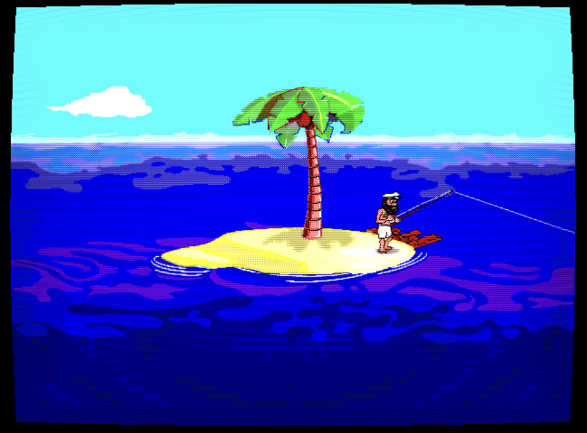
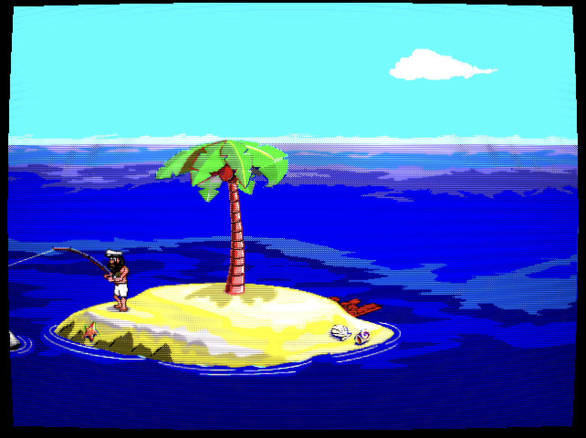

# Johnny Castaway - Reborn (Web)

| Screenshot                           | Screenshot with shader                                  |
| ------------------------------------ | ------------------------------------------------------- |
|  |  |

This is an AI-assisted browser port of the classic [Johnny Castaway](https://en.wikipedia.org/wiki/Johnny_Castaway) screen saver — developed by Dynamix for Windows 3.x and published by Sierra On-Line in 1992, marketed under the **Screen Antics** brand. Written in TypeScript, runs entirely in the browser with no server-side logic. Uses the original screen saver data files, **which are not included**.

This was [originally](https://github.com/gil/jc-reborn-web/tree/v1.0.0) based on the [Johnny Reborn](https://github.com/jno6809/jc_reborn) project, with improvements by comparing the implementation with [Johnny-Castaway-2026-Public](https://github.com/deckarep/Johnny-Castaway-2026-Public), [JohnnyCastaway](https://github.com/tallPete/JohnnyCastaway), with extra fixes for color accuracy, opcodes, freezing and glitches.

This new version was almost completely rewritten and verified against a new decompilation of the original screen saver, making it probably the most accurate reimplementation to this date. See [Accuracy improvements](#accuracy-improvements) for what changed.

I've also added some small fixes and features, such as:

- Debug page to preview all the assets.
- Integration with the great [webgl-crt-shader](https://github.com/gingerbeardman/webgl-crt-shader) by [gingerbeardman](https://github.com/gingerbeardman).

## Setup

### Data files (Not included!)

You need the two original data files placed in `public/data/`:

| File           | Size (bytes) | MD5                                |
| -------------- | ------------ | ---------------------------------- |
| `RESOURCE.MAP` | 1461         | `8bb6c99e9129806b5089a39d24228a36` |
| `RESOURCE.001` | 1175645      | `374e6d05c5e0acd88fb5af748948c899` |

### Sound files (optional)

Place WAV files in `public/data/`. They can be obtained from the [JCOS project repository](https://github.com/nivs1978/Johnny-Castaway-Open-Source/tree/master/JCOS/Resources).

| File        | MD5                                |
| ----------- | ---------------------------------- |
| sound0.wav  | `53695b0df262c2a8772f69b95fd89463` |
| sound1.wav  | `35d08fdf2b29fc784cbec78b1fe9a7f2` |
| sound2.wav  | `f93710cc6f70633393423a8a152a2c85` |
| sound3.wav  | `05a08cd60579e3ebcf26d650a185df25` |
| sound4.wav  | `be4dff1a2a8e0fc612993280df721e0d` |
| sound5.wav  | `24deaef44c8b5bb84678978564818103` |
| sound6.wav  | `eb1055b6cf3d6d7361e9a00e8b088036` |
| sound7.wav  | `cab94bace3ef401238daded2e2acec34` |
| sound8.wav  | `39515446ceb703084d446bd3c64bfbb0` |
| sound9.wav  | `f86d5ce3a43cbe56a8af996427d5c173` |
| sound10.wav | `5b8535f625094aa491bf8e6246342c77` |
| sound12.wav | `8c173a95da644082e573a0a67ee6d6a3` |
| sound14.wav | `e064634cfb9125889ce06314ca01a1ea` |
| sound15.wav | `b3db873332dda51e925533c009352c90` |
| sound16.wav | `2eabfe83958db0cad77a3a9492d65fe7` |
| sound17.wav | `2497d51f0e1da6b000dae82090531008` |
| sound18.wav | `994a5d06f9ff416215f1874bc330e769` |
| sound19.wav | `5e9cb5a08f39cf555c9662d921a0fed7` |
| sound20.wav | `80e7eb0e0c384a51e642e982446fcf1d` |
| sound21.wav | `1a3ab0c7cec89d7d1cd620abdd161d91` |
| sound22.wav | `a0f4179f4877cf49122cd87ac7908a1e` |
| sound23.wav | `52fc04e523af3b28c4c6758cdbcafb84` |
| sound24.wav | `5a6696cda2a07969522ac62db3e66757` |

## Running

```sh
pnpm install
pnpm dev
```

Open `http://localhost:5173`.

To debug assets, open `http://localhost:5173/debug.html`

## Controls

Hover over the canvas to reveal the control bar (top-right corner):

| Control             | Action                                           |
| ------------------- | ------------------------------------------------ |
| 🔇 / 🔊             | Toggle sound (first click activates audio)       |
| ⛶                   | Toggle fullscreen                                |
| 📺                  | Toggle CRT scanline effect                       |
| Double-click canvas | Toggle fullscreen                                |
| `H`                 | Toggle debug HUD (FPS, scene name)               |

## Building

```sh
pnpm build
```

Output goes to `dist/`. Serve as a static site.

## Accuracy improvements

The [first version](https://github.com/gil/jc-reborn-web/tree/v1.0.0) was mostly a port of jc_reborn plus guesswork. This version checks each part against the original Windows program (`SCRANTIC.SCR`). The original's code runs in an emulator ([Unicorn](https://www.unicorn-engine.org/)), and our code must give the same results. The full notes are in [`docs/re/`](./docs/re/).

- **Method**
  - `SCRANTIC.SCR` is decompiled with Ghidra. Every function the port uses is named and tracked in [`docs/re/function-map.md`](./docs/re/function-map.md).
  - Most parts have tests that run the original code and ours on the same input. For the file decoders, that covers every file in the game data.
  - Every old bug fix was reviewed against the original. Most were patches for problems the original never had, so they were deleted.
- **Loading game files**
  - Decompression (RLE and LZW) gives exactly the same bytes as the original, for every file.
  - `RESOURCE.MAP` entries hold a hash of the file name, not a file length as we thought.
  - The parts inside a file are found by name path, like the original, instead of by a fixed order.
  - Palette: brightness levels were slightly off (level 32 gave 130 instead of 128), and the palette has 16 colors, not 256.
  - Background screens: color 0 is a solid color, not see-through.
  - Animation (TTM) and scene (ADS) scripts load and index like the original. The old ADS code had wrong sizes for some instructions, so it sometimes read the next instruction as part of the previous one.
- **Drawing**
  - The layer system is gone. The old code gave each animation its own see-through layer and stacked them every frame. The original draws on 3 screen buffers and erases by copying back only the areas that changed. We do the same now.
  - Sprites, including mirror, flip, and stretch, match the original pixel for pixel on every image.
  - Dithered colors (two colors mixed in a pattern to fake a third) work. The old code cut colors down and never dithered.
  - Pixels, lines, boxes, and circles follow the original's rules.
  - All 6 original screen wipes are back: circle, rectangle, and 4 directions.
  - Deleted the old workarounds ("lingering layers", "saved zones", clearing between scenes).
- **Animation player (TTM)**
  - Rewritten from the original. Scripts run in pages, each with its own delay. The old code kept one running position and had no pages.
  - Jumps to labels find both label types. The old code ignored one.
  - Palette changes wait for the right moment instead of applying at once.
  - Sounds no longer play again when a page repeats.
- **Scene player (ADS)**
  - Rewritten from the original. It decides which animations run, in what order, and when a scene ends.
  - Deleted the old patches: force-stopping stuck animations after 100 ticks, cleanup sweeps, the "cascade" fallback, and the second pass. All scenes now end on their own, and a test plays every one of them to the end.
  - Draw order (which animation is on top) follows the original.
- **Story**
  - The random number generator is ported from the original, replacing `Math.random`.
  - The scene table, times of day, and holidays come from the original.
  - Picking the next scene follows the original rules. The "pick anything" fallback is gone.
  - The main loop does what the original's step does, in the same order. The old phase machine is gone.
  - Deleted the 8000-tick watchdog that force-ended long scenes. The original has no time limit.
  - Settings (`SCRANTIC.INI`) are saved in the browser's local storage.
- **Island**
  - Ocean, raft, island, clouds, waves, surf, and holiday decorations are drawn and animated like the original.
  - Clouds follow the original rules (15 slots, 30% chance each, fixed kinds and heights) instead of being random.
- **Walking**
  - The jc_reborn path search is gone. The original uses fixed route tables with percent choices, and those tables are now taken byte for byte from the original.
  - Johnny turns one direction per frame, moves every 4 clock ticks, and no longer rests 80 ticks when he arrives.
  - Only the palm trunk is drawn over him, not the leaves.
  - A test checks our walk against a step-by-step trace of the original's walk.
- **Timing**
  - The clock ticks every 16 ms like the original, but reads the time in 55 ms jumps, as Windows 3.x did. This makes the walk speed match.

## Thanks

[Jérémie GUILLAUME (jno6809)](https://github.com/jno6809) for the [Johnny Reborn](https://github.com/jno6809/jc_reborn) code and hard work, including the following people that assisted them on this journey:

- Hans Milling aka nivs1978, author of the JCOS project - main source of info for my first lines of the Johnny Reborn code
  - https://github.com/nivs1978/Johnny-Castaway-Open-Source
  - http://nivs.dk/jc/
- Alexandre Fontoura aka xesf, author of castaway project - similar to Johnny Reborn, but in Javascript
  - https://github.com/xesf/castaway
  - https://castaway.xesf.net/viewer/
- The Sierra Chest website, which has a nice section about Johnny Castaway, with many screenshots and video captures. Those turned out to be quite helpful:
  - http://sierrachest.com/index.php?a=games&id=255&title=johnny-castaway

Hans Milling thanks a number of people for giving him (or helping him find) some info about the original engine. They should not be forgotten, and I thank them - indirectly - as well:

- Jeff Tunnel - For helping getting in contact with some of the original developers
- Kevin and Liam Ryan - Assisting with information about the resource files
- Jaap - Helping in finding the format of the resource files
- Gregori - Assisting with the Lempel-Ziv decompression
- Guido - The author of the xBaK project that led to understanding the TTM and ADS commands.

Thanks to the authors of the following projects as well that were used for inspiration for engine optimizations and fixes:

- [Ralph Caraveo](https://github.com/deckarep) for [Johnny-Castaway-2026-Public](https://github.com/deckarep/Johnny-Castaway-2026-Public)
- [Peter Smith](https://github.com/tallPete) for [JohnnyCastaway](https://github.com/tallPete/JohnnyCastaway)

And finally, thanks to [Matt Sephton (gingerbeardman)](https://github.com/gingerbeardman) as well for the [webgl-crt-shader](https://github.com/gingerbeardman/webgl-crt-shader).
